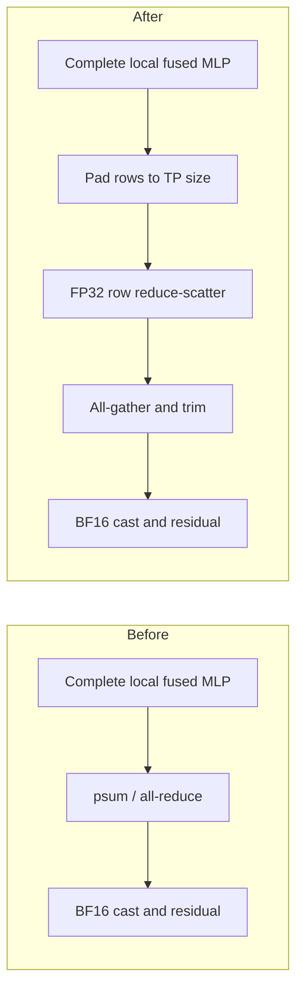

# Clef Pallas tensor parallelism

The experimental `impl="pallas"` path fuses RMSNorm and input projection, and RMSNorm, gate/up, SwiGLU and down projection. Activated intermediates remain in VMEM; down accumulates each output tile across the complete local intermediate width before writing it. Every custom dot dimension is at most 512 and a multiple of 256. `auto` continues to select the JAX implementation for Clef.

The TP mesh uses `jax.experimental.mesh_utils.create_device_mesh`. On the measured single-host v6e-4, its physical 2×2 coordinates map device IDs 0,1,2,3 to `(0,0),(1,0),(0,1),(1,1)` and the topology-aware logical order is 0,1,3,2. Other devices use the ordering selected by JAX rather than a hardcoded permutation.

The MLP sums FP32 local partials with row-wise reduce-scatter followed by all-gather, then casts to the activation dtype and adds the residual. Uneven flattened row counts are zero-padded to the TP size before reduce-scatter and trimmed after all-gather. The mixer output reduction is unchanged.



This makes the collective stages explicit and lets the TPU compiler choose a dedicated reduce-scatter implementation. Both stages still follow the complete local GEMM; this change does not implement compute/communication overlap.

## Measurements

Final PR revision, one sequential sweep on 2026-10-16, JAX 0.11.2, TPU v6e-4; synthetic BF16 MLP with R2048,D5120 and local F4352. Each configuration used four warmups and 15 host-synchronized measurements. All configurations used the same fused Pallas implementation and dot sizes.

| Logical mesh order | Collective | Median host-synchronized MLP time |
|---|---|---:|
| 0,1,2,3 | psum | 1514.64µs |
| 0,1,3,2 | psum | 1505.61µs |
| 0,1,2,3 | RS→AG | 1488.53µs |
| 0,1,3,2 | RS→AG | 1480.04µs |

The combined change reduced this microbenchmark latency by 2.28%. This comparison is against the same Pallas kernel with the original mesh/psum, not against JAX kernels; it is not an end-to-end model speedup or a statistically established improvement. Different reduction orders produced maximum BF16 output differences of 0.015625 (raw) and 0.03125 (topology), within `atol=.04, rtol=.02`.

Compiled TP4 evidence selected `UniDirection1DRingStrategy`/`RotatedPincerEmitter` for psum and `SingleInputAllReduceScatterFusion`/`StrategySubgroupND` for explicit RS. The latter padded 2048 rows to 2112, produced 528 rows per chip, and used a 48-row neighbor collective-permute to reconstruct 512-row shards before BF16 all-gather. The actual all-gather shard was 5 MiB. These formatting costs are included in the measured total. FP32 operands/reducers and a BF16 all-reduce result alone do not establish the internal wire dtype.

Raw samples: [TP collective measurements](../benchmarks/results/2026-10-16-tp-collectives.json). The earlier diagnostic sweep measured 1.71%; neither sweep used interleaved repetition.

## Validation

CPU suite: 107 passed, 45 skipped; simulated TP1/2/4 collective tests: 12 passed, including uneven row counts and every replicated output shard. TPU fusion/collective tests: 23 passed. Type checking and relevant pre-commit hooks passed.

The full Clef checkpoint passed B1/2/4/8 at S512 against saved JAX outputs: all predicted choices matched, maximum probability error 0.003049. Forward medians were 67.27/129.30/247.54/494.02 ms respectively; these correctness-run timings do not establish an end-to-end speedup. [Checkpoint measurements](../benchmarks/results/2026-10-16-tp-checkpoint.json) include matching source hashes for all 49 source files.

## Reproduction

Clef TP4 synthetic Pallas MLP, original mesh/psum baseline and topology/RS→AG variants (requires four local TPU devices):

```sh
PYTHONPATH=src python benchmarks/tp_collectives.py --out /tmp/clef-tp.json
```

Collective correctness on one, two and four simulated CPU devices, including uneven row counts:

```sh
XLA_FLAGS=--xla_force_host_platform_device_count=4 uv run pytest tests/clef/test_parallel.py
```

TPU fusion and collective correctness:

```sh
PYTHONPATH=src python -m pytest tests/kernels/test_swiglu.py tests/clef/test_parallel.py
```
